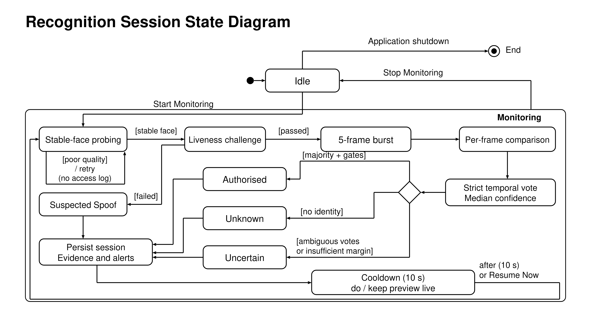

# Architecture

FusionGuard combines a browser interface, a local Flask service, biometric processing modules and MySQL persistence. The browser captures webcam images; the Python service evaluates them locally and returns the session result. Access decisions are displayed and recorded. No physical lock or remote notification service is connected.

## Modules

| Module | Responsibility |
|---|---|
| `app.py` | Routes, administrator sessions, enrolment, recognition orchestration, incidents and guest access |
| `static/app.js`, `templates/` | Camera controls, separate capture bursts, result display, browser alert tone and incident refresh |
| `quality.py` | Face presence, face-region sharpness, brightness and face-size checks |
| `liveness.py` | Blink or head-movement assessment using a separate set of frames |
| `fusionguard_multimodal.py` | Alignment, feature extraction, ArcFace loading, template serialization and comparisons |
| `fusion_math.py` | Component weights, Mahalanobis evidence mapping and logistic fusion |
| `temporal_verifier.py` | Strict majority and median supporting-frame confidence |
| `guest_keys.py` | Random key generation, hashing, validity and usage checks |
| `db.py`, `config.py` | Persistence, schema compatibility and environment configuration |

## Recognition cycle

1. Stable-face probing checks quality without creating access logs. Three consecutive usable probes trigger a capture cycle.
2. The browser collects four liveness frames and a separate five-frame recognition burst, then submits both. The server evaluates liveness first. A failed challenge produces a **Suspected Spoof** result.
3. Usable recognition frames are aligned and compared against each active user's enrolment views. Each user contributes their best-scoring angle. The leading identity must pass the component gates and lead the runner-up by at least three fusion-score points.
4. At least three usable recognition frames are required. Authorization requires `floor(usable_frames / 2) + 1` votes for one identity. Frames without an accepted identity count against that majority. Confidence is the median logistic match score of the winner's supporting frames.
5. No accepted identity votes produces **Unknown**. Positive identity votes without a strict majority produce **Uncertain**. Completed outcomes are persisted, followed by a ten-second cooldown; preview remains visible, and **Resume Now** can end the cooldown early.

The diagram summarizes the logical decision sequence. Capture happens in the browser before the server evaluates the submitted liveness and recognition frames; the rules above describe the implemented vote outcomes.

### Fusion and limitations

The weighted score combines ArcFace (75%), periocular geometry (15%), Mahalanobis-derived evidence (7%) and iris/LBP (3%). Logistic mapping uses center 68 and scale 4. A comparison requires a logistic match score of at least 0.5, ArcFace cosine distance at most 0.68, and Mahalanobis distance at most 3. These values are configurable. Displayed component percentages and session confidence are not measured accuracy rates.

Liveness detects a blink **or** sufficient head movement across at least three detectable-face frames. It is a basic challenge, not a validated defence against every photograph or replay attack. Lighting, face size and camera quality affect capture. No formal biometric benchmark on a representative dataset is included in the repository.

## Stored data

| Tables/storage | Contents |
|---|---|
| `administrators`, `audit_logs` | Password hashes and administrator-action history |
| `authorised_users`, `enrollment_samples` | Active users, descriptive roles, four view labels, image paths and compressed biometric templates |
| `recognition_sessions`, `recognition_frame_results` | Final outcomes, liveness details, votes, component scores and supporting evidence |
| `incidents`, `alert_logs` | Review status, notes, severity and persistent alert records |
| `guest_keys`, `guest_access_logs` | Key hashes/last four digits, validity, limits, revocation and access history |
| `static/uploads/` | Private enrolment captures, recognition frames and incident images |

Guest keys contain eight random digits. The database stores a peppered hash and the last four digits; the newly generated plaintext is shown once to the administrator. Guest entry checks validity, revocation and remaining uses. Rejected attempts create incidents; successful entry is recorded as guest authorization.

Deleting selected incident logs removes incident and alert rows while retaining recognition sessions and captured images. Disabling a user preserves their enrolment data. Evidence files reside under Flask's static directory and are directly served when their URLs are known. The repository contains only empty upload-folder placeholders. Personal captures, database exports and credentials are excluded by `.gitignore`.
